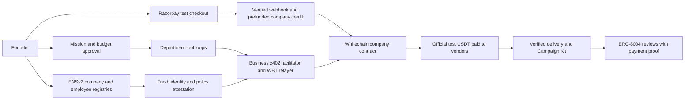
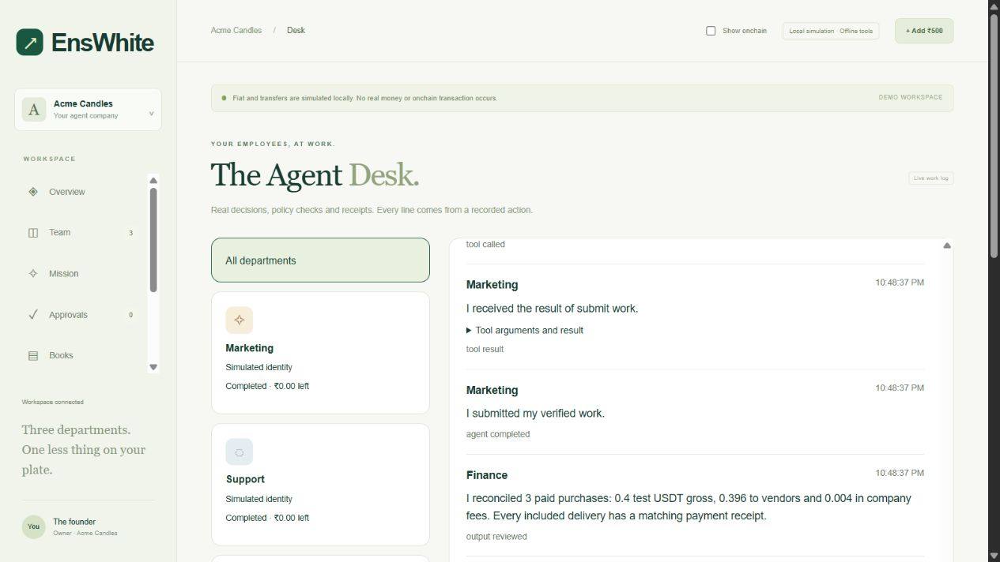
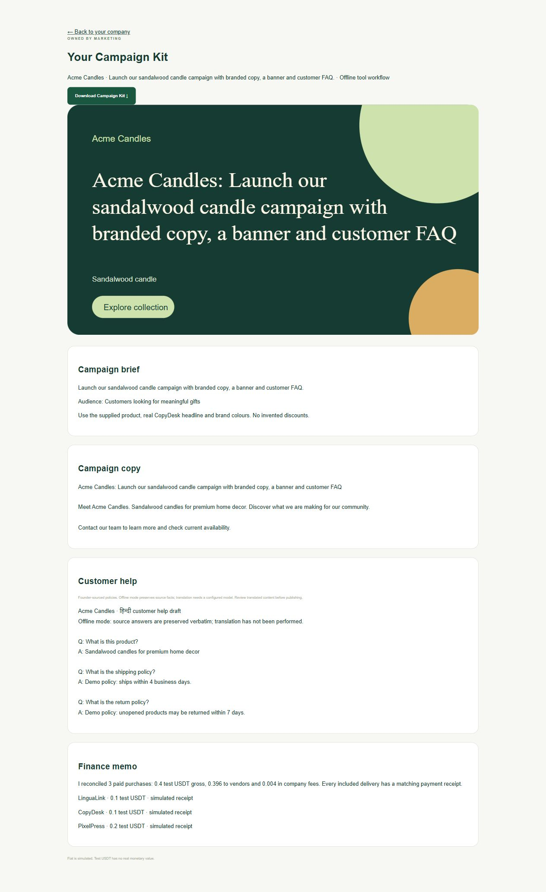
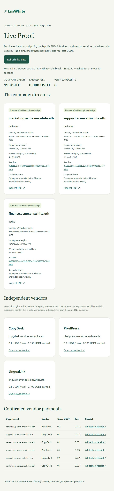

# EnsWhite

**Submission: Whitechain Scale + Best Use of ENSv2.** [Hosted guest demo](https://enswhite.onrender.com/) · [Live Proof](https://enswhite.onrender.com/proof/) · [Operator-hosted real onboarding](https://zoning-playhouse-banister.ngrok-free.dev/launch/) · [Requirement-to-evidence checklist](docs/SUBMISSION.md) · [3:15 demo recording script](docs/DEMO-VIDEO.md). **Video recording/upload remains pending.** Source is [MIT licensed](LICENSE).

Whitechain lets each vendor verify an actual USDT settlement while the company contract atomically enforces spending limits, allowlists, replay protection and ENS-bound policy. A regular payment rail would need a separate trusted ledger and confirmation integration; it cannot itself produce the contract's Paid event. The founder's Razorpay edge is simulated fiat, not conversion.

[Acme](https://explorer.testnet.whitechain.io/address/0xbca635f00C07681f10269f69ca293bDB6536D6aB/contracts), [Cedar Studio](https://explorer.testnet.whitechain.io/address/0xDD9E8EdD5488B9DfBb3AE6f98FdA10b3E7d3EbAd/contracts), [Swap Mobile](https://explorer.testnet.whitechain.io/address/0x005d2a5A578fE3A048F6B69Df6146F42E29E8dEa/contracts) and [CrazyMobs](https://explorer.testnet.whitechain.io/address/0x25643a29809999B5134B0aaB4f0Ac717b3100A12/contracts) are source-verified. [Live payment/verification check](docs/deployments/submission-checks.json); reproduce with `node app/verify-submission.js` (read-only).

**Start a business, hire AI departments and let them buy the work—within a budget, with a receipt.**

[Launch a company](https://zoning-playhouse-banister.ngrok-free.dev/launch/) · [Guest company](https://enswhite.onrender.com/) · [Live Proof](https://enswhite.onrender.com/proof/) · [Founder workspace](https://zoning-playhouse-banister.ngrok-free.dev/owner/) · [Architecture diagrams](docs/project-flow.md)

Public routes require `start-judge.ps1` running and the tunnel forwarded to **3006**. Private company/vendor services remain on **3004 / 4001–4003**. See [activation](docs/ACTIVATION.md) and the [six-step journey/operator guide](docs/FOUNDER-JOURNEY.md). The temporary tunnel depends on the operator's machine staying online. Demo recording remains deferred.

A founder describes their business and gives a mission. Marketing, Support and Finance run persisted, role-specific tool loops with memory and structured handoffs. Marketing commissions copy, passes the delivered text and brand to design, and owns the Campaign Kit. Support uses founder-supplied product/shipping/return facts. Finance proposes task-based allocations for approval and reconciles actual receipts. Models never receive keys or unrestricted transaction tools.

The front follows Launch → Hire → Fund → Work → Deliver → Review. New visitor onboarding provisions a separate ENS namespace, employee wallets/identities and Whitechain contract under daily operator budgets. Vendor reputation is queried with a non-empty company-department client list. The complete flow is now live-verified for Cedar Studio: 33 setup transactions, a captured ₹500 sandbox top-up, task-based allocations, a real-model three-vendor mission and six confirmed ERC-8004 reviews. See [transaction evidence](docs/deployments/cedar-studio-1107.json). New launches still require the local operator activation steps.

Hire, Fire and Renew now queue through the authenticated app, with a separate private employee manager sponsoring ENS service gas. The founder needs no browser wallet for these actions. See [employee-manager setup and trust boundary](docs/EMPLOYEE-MANAGEMENT.md); the operator must start the manager and reload the company server to activate it.

[Employee runtime, sample tool trace and local commands](docs/EMPLOYEE-RUNTIME.md) · [Completed offline Kit](https://enswhite.onrender.com/sample-kit.html) · [Whitechain feedback](WHITECHAIN_FEEDBACK.md)

Private model mode fails explicitly on an API error; it does not disguise an offline substitute as AI work. Guest sessions execute the same bounded tool interface offline and label that source. New model assignments allow six tool decisions and twelve API attempts; saved legacy and offline runs retain their original eight-tool protocol. A GPT-6 Luna mission passed with simulated settlement using five/two/two decisions for Marketing/Support/Finance. Real-model missions completed with simulated funds and real Whitechain testnet payments on November 7, 2026. The [live-testnet Campaign Kit evidence](docs/TESTNET-RUNTIME-MISSION.md) records all three employee submissions, vendor receipts, recovery behavior and content-review limits.

**Sandbox fiat; real testnet settlement.** ₹500 in Razorpay test mode credits 5 test USDT from a prefunded company contract. This is a fixed demo allocation, not fiat conversion. Guest companies use isolated simulations and offline content; authenticated founders can configure OpenAI planning/content locally. Test USDT has no real monetary value.

| Company workspace | Campaign Kit—local simulation | Live Proof—real testnets |
|---|---|---|
|  |  |  |

## For Whitechain judges

Scale: one continuous flow from founder funding to an agent buying a service, a vendor getting paid and a usable delivery with receipts. Departments sign EIP-3009 authorizations and hold zero WBT. The business relayer pays gas. The company contract enforces spending limits and records receipts.

- [Verified identity-enforcing company contract](https://explorer.testnet.whitechain.io/address/0xbca635f00C07681f10269f69ca293bDB6536D6aB/contracts)
- [CopyDesk payment](https://explorer.testnet.whitechain.io/tx/0x7123f986638ac983243ba7c024a7cdd3acc0396ce0a8c2aa1b315de397e41cd0)
- [LinguaLink payment](https://explorer.testnet.whitechain.io/tx/0x1dfda793a10e024f3a82acc4c6719fc3656315cf3ade74c3c864237b1bdc5f9f)
- [PixelPress payment](https://explorer.testnet.whitechain.io/tx/0x811232ee8b0ecb69ced740e321110a7805d251613f16edde7d6f9d859543ab4e)

Our HTTP 402 flow uses the **custom `enswhite-receive` scheme**: the buyer authorizes the company contract, which pays the vendor and retains 1%. Standard exact clients are not automatically compatible. The gas watcher can withdraw earned fees and swap them on YetiTrade under bounded limits; no live swap was forced for this demo. The relayer daily cap, vendor allowlist, contract limits and founder approvals constrain spending.

## For ENS judges

ENS is the live employment and policy authority. Before signing, the backend resolves employee and vendor through Sepolia's Universal Resolver, checks employment/expiry, wallet, endpoint and spending records, then attests a request-bound policy for Whitechain. Removing ENS removes portable employment, live revocation/expiry checks and Finance's shared delegated budget record.

- [Separate Sepolia enswhite.eth registration](https://sepolia.app.ens.domains/enswhite.eth)
- [Marketing employee name](https://sepolia.app.ens.domains/marketing.acme.enswhite.eth)
- [Scoped Finance budget edit](https://sepolia.etherscan.io/tx/0x3accfeaef63305ea8509f6ebe9ed9b5f0f522e78c4583d14a149de53916d73e0)
- [Support rehire after the live firing/expiry demo](https://sepolia.etherscan.io/tx/0x58bb4e98c6000f0e5f77fd9e411c9d2d460c20283d0fb4bff5d251347477f191)

This uses ENSv2 UserRegistries, expiring non-transferable employee badges and per-key Permissioned Resolver roles. Vendor registry revocation rights were removed, but the ancestor namespace owner retains its subregistry-pointer control. Cross-chain policy uses a trusted attester, not a trustless ENS bridge; already-signed policies may remain usable for up to 60 seconds after firing.

[ENSIP-25](https://docs.ens.domains/ensip/25) and [ENSIP-26](https://docs.ens.domains/ensip/26) are draft discovery standards. **Three [ERC-8004](https://eips.ethereum.org/EIPS/eip-8004) identities and their ENS bindings are live on Sepolia:** Marketing 11295, Support 11296 and Finance 11297. Current-owner/wallet verification and the replacement company-directory pointer were independently checked after migration; see [public deployment evidence](docs/DISCOVERY-VERIFICATION.md). Discovery is separate from payment permission and makes no reputation or validation claim. Published web records require the public services to be running.

## Run and verify

Node 22.13+, `npm ci`, `npm test`. For a disposable public demo: `node app/judge-server.js`, then open `http://localhost:3006`. It starts simulated vendors inside each guest's isolated workspace. Sessions expire after one hour, permit five missions and never use the host's paid model key. Live Proof needs RPC connectivity, no signer.

The public landing page uses the Stipple / Pointillism design tokens, inline SVG icons and a light/dark theme. Shared colors and type live in `app/styles/tokens.css`; the landing and app layouts live in `app/styles/landing.css` and `app/styles/app-theme.css`. Run `npm run build:ui` to regenerate and sync the committed styles and theme controls across onboarding, workspaces and proof pages. Production serves the built file without Tailwind or a CDN at runtime. The three pricing cards show demo task costs; testimonial-style scenarios are explicitly illustrative.

[Activation and local model setup](docs/ACTIVATION.md) · [Full operator runbook](docs/RUNBOOK.md) · [Deployment/proof manifest](docs/deployments/enswhite-testnets.json) · [Diagrams with speaker notes](docs/project-flow.md)
