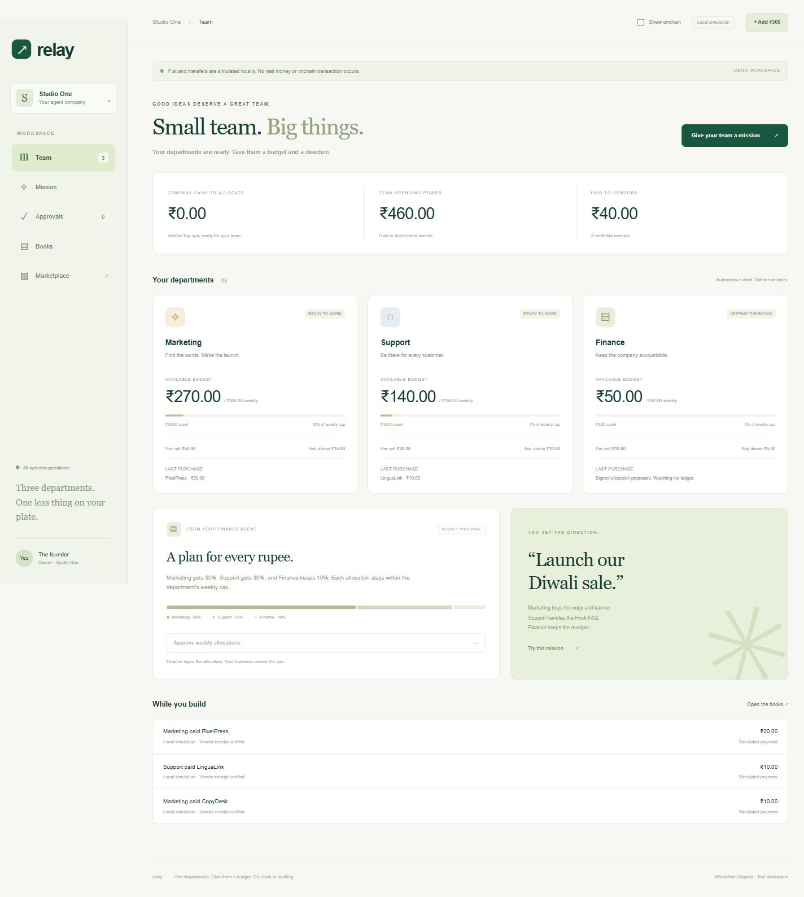

# Relay

**Hire AI departments, give each a budget, and the books close themselves.**

Relay is the money layer for a solo founder's agent company: corporate cards and expense reports for AI employees. Marketing buys copy and a banner. Support buys a translated FAQ. Finance signs allocations, reconciles receipts and flags above-threshold spending. Every vendor payment goes to an independent vendor wallet; departments never pay each other.

**Fiat is simulated. This runs on Whitechain Sepolia and uses test USDT with no real monetary value. No fiat-to-USDT conversion occurs.** The demo allocation is INR 500 → 5 test USDT (INR 100 per test USDT for the founder's display). This is a fixed demo allocation, not an exchange rate.



## Run locally

Requires Node.js 22.13+, Git and, for Solidity, Foundry (tested with 1.4.4).

```powershell
git clone --recurse-submodules https://github.com/swapnilyt1234/relay-agent-company.git
cd relay-agent-company
npm ci
npm test
npm run company
```

Open **http://localhost:3003**. The launcher starts four independent Node processes: the company on 3003, CopyDesk on 4001, PixelPress on 4002 and LinguaLink on 4003. Stop with Ctrl+C. Stop the simulated vendor group before running testnet vendors, because both modes use ports 4001–4003.

1. **Add INR 500**: locally simulates a captured payment, attestation and company credit.
2. **Approve weekly allocations**: Finance signs 60/30/10 allocations within weekly caps.
3. Open **Mission** and launch the Diwali campaign.
4. CopyDesk and LinguaLink deliver after payment. PixelPress waits under **Approvals** because its INR 20 price exceeds Marketing's INR 15 threshold.
5. Approve the banner. PixelPress verifies its payment and delivers an SVG.
6. Open **Books** for the event-derived ledger and accountant CSV. **Show onchain** reveals addresses and, in testnet mode, transaction links.

Simulated payments are labeled and never linked to an explorer. The earlier payment lab is preserved with `npm start`; it uses separate state. See [its notes](docs/payment-lab.md).

## Departments and independent vendors

| Department | Weekly cap | Per-call cap | Daily cap | Approval above |
| --- | ---: | ---: | ---: | ---: |
| Marketing | INR 300 | INR 50 | INR 300 | INR 15 |
| Support | INR 150 | INR 20 | INR 150 | INR 10 |
| Finance | INR 50 | INR 10 | INR 50 | INR 5 |

| Vendor | Service | Gross price | Net receipt | Port |
| --- | --- | ---: | ---: | ---: |
| CopyDesk | Advertising copy | 0.1 test USDT / INR 10 | 0.099 test USDT | 4001 |
| PixelPress | SVG campaign banner | 0.2 test USDT / INR 20 | 0.198 test USDT | 4002 |
| LinguaLink | Hindi / Marathi FAQ | 0.1 test USDT / INR 10 | 0.099 test USDT | 4003 |

Each vendor has its own encrypted wallet, process, order database and earnings page. In testnet mode, `/api/earnings` reads `Paid` events directly from Whitechain filtered by its address. Before delivery, the vendor independently checks the transaction receipt, company contract, request ID, department, vendor and amount. It never trusts a backend declaration of payment. The local simulator uses an explicitly labeled local event store.

## What enforces the money

[RelayCompany.sol](src/RelayCompany.sol) implements:

- `topUp`: EIP-712 attestation credits only prefunded USDT. Each Razorpay payment ID works once. The backend first verifies the exact raw webhook HMAC and independently checks captured status, local order, INR currency and amount through Razorpay's API.
- `allocate`: owner or Finance transfers credited funds to a registered department.
- `allocateBySig`: Finance signs an allocation; the relayer pays gas. Finance therefore needs no WBT. Its nonce prevents replay.
- `registerVendor` / `setLimits`: owner-only vendor prices and department per-call/day caps.
- `pay`: recomputes `keccak256(abi.encode(vendor, requestId, salt))`, checks the registered price, call/day limits and request replay, then executes the department's signed `ReceiveWithAuthorization`. Only the named recipient, RelayCompany, can execute it. The contract sends the vendor the amount minus 1% and emits `Paid`.
- `withdrawFees`: owner-only withdrawal of the recorded USDT fee pool. Company credit is not withdrawable as fees. This does not automatically convert USDT to WBT.

The backend reserves budget before signing, enforces weekly caps and founder thresholds, and records approval decisions. Models may propose allowed vendor work; they never choose signing keys, wallet addresses, prices or permissions. A compromised department key can lose its allocated token balance; **there is no claim that a stolen key cannot transfer tokens directly**. Department wallets hold zero WBT and only their allocations.

Signed transactions are saved before broadcast. Unknown broadcasts keep their original bytes and reservations. Vendor delivery retries after confirmed payment do not charge again. Finance signs internal allocations; departments only pay external vendors.

The relayer holds WBT and no USDT. The attester holds neither asset and signs payment confirmations only. Treasury prefunding is signed by the separate USDT treasury and relayed using WBT gas. Relayer code checks a minimum gas balance, caps each transaction at 600,000 gas and estimated 0.05 WBT, and limits newly signed jobs to 120 per day in this single-process demo.

## Optional model-backed agents

Without credentials the UI explicitly labels **seeded fallback** briefs, copy and FAQ. PixelPress deterministically renders an SVG. With a model, Marketing chooses copy, a banner or both, and Support chooses a translation brief; code validates the resulting vendor choices and ignores untrusted extra fields.

Copy [.env.company.example](.env.company.example) to `.env.company`. To enable model-backed work, set `AGENT_MODE=llm`, `OPENAI_API_KEY`, and an `OPENAI_MODEL` available to your account. Calls use the [OpenAI Responses API](https://developers.openai.com/api/docs/guides/text), with an eight-second timeout and fallback. The company loads its own `.env.company`, keeping the original lab's `.env` separate. Never commit API keys.

## Real company deployment

The earlier payment lab already completed real testnet USDT payments. The new [RelayCompany is deployed and verified](https://explorer.testnet.whitechain.io/address/0xD36605397FaFefaAe2c3eBfA95af1c732A322B31/contracts) on Whitechain Sepolia, at deployment block **12328348**. Owner configuration, pool funding and a live company mission must also complete; a local fork or simulated run is not evidence of a live mission. The earlier wallet and balance are not silently migrated.

Run these from `C:\Users\swapn\Desktop\ethglobal` in your own PowerShell terminal:

1. Run `npm ci`, `git submodule update --init --recursive`, `forge build` and `forge test -vv`.
2. Run `./prepare-company.ps1`. It creates encrypted `relay-relayer`, `relay-treasury`, `relay-attester` keystores, department wallets and vendor wallets, without printing private keys or overwriting existing keystores. It prints the exact `forge create --broadcast --verify` command with constructor arguments last. Run that command.
3. Run its two printed funding commands: **0.2 test WBT to the relayer** and **10 test USDT to the treasury**, from your existing business wallet. Keep the attester empty.
4. Read the deployment block from the explorer. Run `./configure-company.ps1 -CompanyAddress 0xYOUR_COMPANY -DeploymentBlock YOUR_BLOCK`. After a summary and confirmation, it unlocks the owner wallet once and configures Finance, three department limits and three vendor prices. Already-applied settings are skipped, so it safely resumes a partially completed setup. Signed transactions are journaled before broadcast.
5. Run `./fund-company-pool.ps1`. After confirmation, the treasury signs a **10 test USDT** transfer into the pool; the separate relayer submits it and pays gas. The helper saves the signed transaction before sending. Do not delete that journal to blindly repeat a pending transfer.
6. Stop the simulated vendor group and run `./start-company-testnet.ps1`. Enter your public HTTPS origin forwarded to **3004**, Razorpay TEST credentials, relayer and attester passwords, and a founder sign-in password of at least 12 characters. Review the signing policy and type `yes`.
7. Set Razorpay's test webhook to **`https://YOUR-ORIGIN/api/webhooks/razorpay`**, event **`payment.captured`**, with the same webhook secret. Use automatic capture. The URL path is required; `/` returns 404. [Razorpay webhook validation](https://razorpay.com/docs/webhooks/validate-test/).
8. Open the public app, sign in, make the INR 500 **test-mode** payment, allocate, launch a mission and approve the banner. Record the actual company `Paid` links from Books.

All passwords are entered locally and passed through process environments, never command arguments or chat. Private state lives under `data/company/<mode>` and `data/vendors/<mode>`. Department/vendor keys use AES-256-GCM; the role wallets use encrypted Ethereum keystores. Back up the encrypted database and local encryption key together and restrict OS access. Losing keys or founder access is not recoverable through this demo. Changing modes or company addresses requires a fresh company data directory.

## Custom x402 scheme

The company implements **`relay-receive`**, a custom scheme over x402 v2 HTTP headers on **`eip155:1874`**. It is deliberately **not called standard `exact`**: that scheme normally signs `TransferWithAuthorization`, whereas Relay signs `ReceiveWithAuthorization` to an enforcing contract.

Vendors return `402` with `PAYMENT-REQUIRED`. Relay checks policy, reserves budget, signs a vendor/order-bound authorization and relays `pay`. `PAYMENT-RESPONSE` carries the confirmed transaction, which the vendor verifies before delivery. Authenticated facilitator endpoints are `/api/x402/supported`, `/api/x402/verify` and `/api/x402/settle`. This is a company-specific facilitator, not a hosted Whitechain service or universal SDK integration. References: [x402 v2](https://github.com/coinbase/x402/blob/main/specs/x402-specification-v2.md), [HTTP transport](https://github.com/coinbase/x402/blob/main/specs/transports-v2/http.md).

## Checks and transaction evidence

```powershell
npm test
forge test -vv
$env:WHITECHAIN_FORK_TEST='true'
try { forge test --match-contract RelayCompanyForkTest -vv }
finally { Remove-Item Env:WHITECHAIN_FORK_TEST }
```

Backend tests cover the company mission, allocations, approvals and reservation release, independent vendor receipt rejection and task binding, ambiguous broadcast recovery, founder sign-in, webhook forgery, session isolation and x402 retries. Contract tests cover replayed payment IDs and requests, unbacked credit, unregistered/redirected vendors, per-call/day limits, fee math, unauthorized allocations and Finance signature replay.

**The new contract passed a local fork test using actual Whitechain USDT**: a zero-WBT department signed the bound receive authorization, the contract paid the vendor net of fees, and company credit remained correctly accounted. Fork tests require explicit opt-in and never broadcast.

Real transactions from the earlier payment milestone:

- [Treasury → agent: 1 test USDT](https://explorer.testnet.whitechain.io/tx/0x0d1d24d4c98021cd5ee8f52f5a88254e6aa541af37a7b99b50ab42f5c6d22b53).
- [Agent → merchant: 0.1 test USDT](https://explorer.testnet.whitechain.io/tx/0xd93c87461e442eaa13d27cb8471721d7a95036ba91243d688444240349ef305a).
- [Successful x402 exact payment: 0.1 test USDT](https://explorer.testnet.whitechain.io/tx/0x69ac20e8501e2345ad7e08855694205d9156174e736d21db831a16cf40e61ddc).
- [Verified storage test contract](https://explorer.testnet.whitechain.io/address/0xEA836Fd7E1179777039856c02b70A3328cD3C1f3/contracts), which is neither RelayCompany nor a USDT payment.

These prove the earlier real-payment milestone. The new company deployment is [0xc003ca83…109b2](https://explorer.testnet.whitechain.io/tx/0xc003ca83d53cd411b65f0e1d6b8c104f4380e2fad32ff3af295c4060e0a109b2), with [verified source](https://explorer.testnet.whitechain.io/address/0xD36605397FaFefaAe2c3eBfA95af1c732A322B31/contracts). Live company `Paid` links will be added after the mission runs. See [architecture](docs/architecture.md) and [earlier lab notes](docs/payment-lab.md).

## Why onchain

Agent departments need bounded spending authority across independent services. A contract enforces vendor allowlists, price limits and replay protection. Vendors independently verify payment without trusting Relay's database, and the shared receipt trail makes the accountant export checkable.

## Limits and roadmap

This is a single-founder, single-process hackathon demo, not production custody or payments infrastructure. Department keys are custodial, fiat is simulated and real operations target testnet. Weekly budgets and approvals are enforced by code; the contract enforces credited allocations, funded wallet balances, allowlisted prices, and per-call/day limits. The owner configures policies and withdraws fees in their own terminal. Paid-but-undelivered work retries delivery; it does not automatically refund.

Sales, Product, Design, Engineering and Operations are the five roadmap departments, not fake working agents. Gas-fee withdrawal exists, but **automatic YetiTrade swapping is not implemented**: collected USDT is not WBT. Inter-company sales, production onramps, treasury replenishment, refunds and account recovery are also outside this core release. Production licensing and KYC require separate market-specific review.

Show every party in the demo: founder, three departments, three vendor earnings pages, relayer gas tank, approval and real company receipt. Never show keys, passwords, API secrets or data files.
