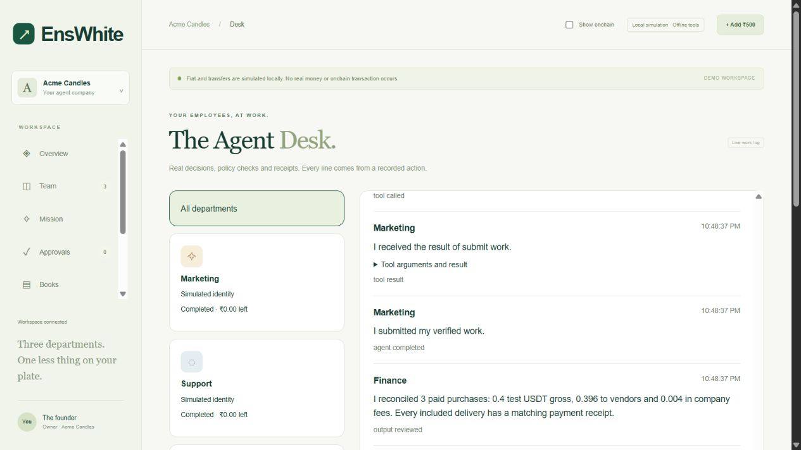

# AI employee runtime

EnsWhite now executes employee tool loops rather than using the model only to return a task list. `agent-definitions.js` defines role prompts and strict function schemas; `agent-runtime.js` drives bounded Responses calls; `agent-tools.js` validates and executes those calls. Existing `company.js`, ENS authorization, EIP-3009 signing, journaled relayer transactions and vendor receipt verification remain the financial authority.

Each assignment permits eight tool calls, twelve API attempts and a three-minute execution window per invocation. Calls are sequential. Paused work resumes on a relevant delivery/funding observation, without polling the model through approval waits. Failed model requests stop explicitly; the backend never substitutes offline work and calls it successful AI work. Saved actions, function results and opaque Responses reasoning items support continuation. User-visible history exposes tool actions and results, not hidden reasoning.

The Responses request uses strict schemas, `parallel_tool_calls: false`, `store: false` and replayed output/function-result items, following the [official function-calling guide](https://developers.openai.com/api/docs/guides/function-calling). No signing material, unrestricted URL tool, token selection or arbitrary contract call is passed to the model. Tool permissions, current employment, quote consistency, founder approvals and contract policies are enforced separately.

## Persistence and accountability

`agent_runs`, `agent_actions`, `agent_messages` and `agent_memory` retain assignments, actions, handoffs and verified completion summaries. `company_profiles` snapshots founder facts for each mission; `mission_deliverables` keeps the campaign brief, sourced FAQ, review and financial report. `agent_quotes` binds each vendor to its original brief. Existing task IDs and payment journals prevent a repeated purchase request from charging again.

An interrupted tool can replay through the same idempotent purchase path. A crash after a verified submission result can recover completion without another model request. A model's plain final message cannot complete an employee: `submit_work` must pass backend artifact/delivery checks. Exhausted or failed runs remain visible; retry uses the saved run and original payment identities.

Authenticated routes: `GET /api/agent-runs`, `GET /api/agent-runs/:id`, `POST /api/agent-runs/:id/retry`, and the existing resumable `GET /api/activity/stream`. Founder-only proposal and approval routes are `POST /api/finance/proposal` and `POST /api/allocate` with `proposalId`.

## Actual sample execution

Run `node app/demo-runtime.js --offline`. This creates disposable simulated company/vendor stores, uses the actual tools and signing/receipt simulation, approves the demo banner, prints the execution and removes the disposable data. It never uses a funded wallet. `--sample` also regenerates the public, clearly labeled offline Kit.

The verified offline Acme Candles run executed:

| Employee | Actual tool sequence | Result |
| --- | --- | --- |
| Marketing | read_context → create_campaign_brief → request_quote(CopyDesk) → purchase_service → read_work → request_quote(PixelPress) → purchase_service → submit_work | 8 calls; actual copy and brand passed to design; founder approval awaited |
| Support | read_context → draft_faq → review_faq → request_quote(LinguaLink) → purchase_service → submit_work | 6 calls; founder shipping/returns facts preserved |
| Finance | read_context → read_ledger → review_spending → propose_allocation → prepare_report (wait) → prepare_report → submit_work | 7 calls; gross 0.4, fees 0.004, vendor net 0.396 simulated test USDT |

These are executed offline tool actions, not evidence of a paid model run. The test suite also completes the same workflow with mocked Responses function calls, exercising model-request/result wiring without sending an API request. The public sample contains no fabricated explorer links.

Finance no longer uses 60/30/10. Startup quotes require 0.3 USDT for copy/banner and 0.1 for translation, less existing spendable balances. Finance saves a rationale and proposal; the founder reviews it before any allocation is signed. Existing controlled purchase-shortfall handling remains separately bounded by the launcher policy and hard limits. The model cannot approve its own proposal or grant itself signing authority.

## Run locally

```powershell
npm test
node app/demo-runtime.js --offline
node app/judge-server.js
```

Open `http://localhost:3006`: enter a guest company, enter product/policy facts, simulate a top-up, ask Finance for a proposal, approve it, assign the mission, approve the banner, and inspect Agent Desk/Deliverables. `/sample-kit.html` needs no session. `/proof/` reads the deployed testnets without signing.

For private model mode, configure `AGENT_MODE=llm`, `OPENAI_MODEL` and `OPENAI_API_KEY` only in ignored `.env.company`, then run:

```powershell
node --env-file-if-exists=.env.company app/demo-runtime.js
```

This exercises the real API against disposable simulated funds; model calls incur the account's API charges. The user explicitly chose offline validation in this pass, so no real-model success is claimed. For the established testnet company, use `start-company-testnet.ps1` and enter secrets locally. Do not run the simulated four-process launcher alongside the real vendors on ports 4001–4003.

The environment example uses fresh workforce-simulated data paths so the new local demo does not reuse or overwrite an older payment-lab simulator. The testnet launcher sets the existing real-testnet paths explicitly.

Public activation in this session was blocked by automatic execution review when attempting to stop the temporary test server and launch a background public service. The ngrok endpoint is still pointed at port 3004. To activate in your own terminal, stop the temporary local test server, after checking that it is the process serving port 3006, run `start-judge.ps1` with the existing origin, and forward the same ngrok hostname to port 3006 as described in [ACTIVATION.md](ACTIVATION.md). The current public prototype still depends on local processes staying online; it is not permanent hosting.

## Current boundaries

- Real model connectivity and model-specific quality remain unverified until the user supplies local configuration. Offline FAQs preserve source facts and explicitly do not claim to have translated them.
- Translation is a draft for founder review. Source checks and payment verification do not prove semantic quality.
- The runtime intentionally supports three fixed employees and the complete commerce-launch workflow. It does not execute arbitrary code, unrestricted agent-to-agent payments, tax/payroll or treasury trading.
- ENS discovery migration is now live and independently verified on Sepolia: Marketing 11295, Support 11296 and Finance 11297. ENSIP-25 consent, ERC-8004 ownership/wallet metadata and ENSIP-26 context/web records are configured. The company pointer now resolves to the replacement directory; Whitechain was not redeployed. See [deployment evidence](DISCOVERY-VERIFICATION.md). Reputation feedback and validation services remain a later identity phase.
- Browser-wallet Hire/Fire, Docker runtime and permanent hosting are not newly validated here. The existing ngrok hostname remains a temporary operator-hosted origin.
- GitHub About was updated through the authenticated owner session to: **EnsWhite: a business OS for AI employees with ENS identities, controlled Whitechain payments and verifiable business deliverables.**


