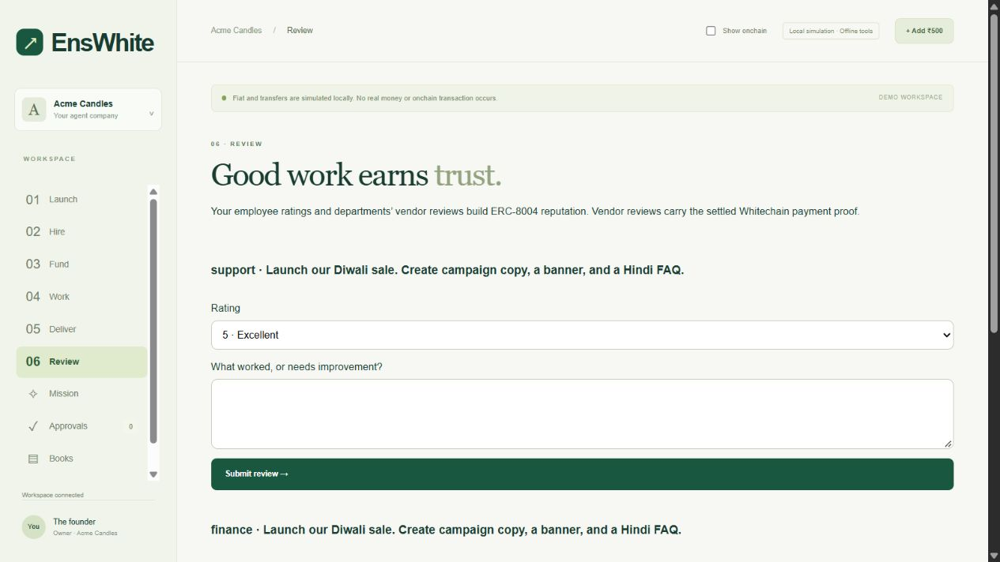

# Launch → Hire → Fund → Work → Deliver → Review

The founder uses a website and Razorpay test checkout. Local private services hold and use the signing wallets. No browser wallet is required for the six steps.

| Step | Actual path | Evidence |
|---|---|---|
| Launch | `/launch/` lets a visitor create another business from a blank onboarding form and switch between their companies. Existing visitor cookies retain access to their original workspace. The private operator calls the existing Sepolia `EnsWhiteNames.createCompany`. | Saved transaction checklist; no name is presented as minted while waiting. |
| Hire | Choose Marketing and/or Support, with Finance included. Each selected role gets a new encrypted wallet, a 30-day ENS hire, Sepolia gas, its own ERC-8004 registration and ENSIP-25/26 records. | Separate links for funding, hire, identity, metadata and record transactions. |
| Fund | Provision a separate Whitechain `EnsWhiteCompany`, its own relayer and attester, fixed limits and vendor prices. Prefund 5 test USDT. A captured ₹500 Razorpay test payment credits 5 units only after webhook signature/API checks. | Separate Whitechain deployment and funding links; confirmed credits and founder-approved Finance allocations. |
| Work | `/company/` gives each hired employee a persisted model loop with six decisions. Tools: find vendors, buy, handoff, ask founder, deliver; Finance also proposes allocations. Fresh ENS context informs the prompt; existing code/contracts enforce authority. | Existing SSE Agent Desk, saved tool calls, approval requests, x402 receipts and handoffs. Waiting buys/questions resume the same call ID. |
| Deliver | Verified vendor delivery unlocks copy, a model-written HTML landing section, translated founder-sourced FAQ and a reconciled Kit. Legacy SVG orders still work. | Downloadable Kit, rupee equivalents and Whitechain transaction links. HTML model text is escaped through a fixed semantic renderer. |
| Review | Departments rate the actual vendor output at submission, once per paid task; authenticated founders rate completed employee assignments. | ERC-8004 feedback transactions and an integrity-hashed JSON file. Vendor `proofOfPayment` includes chain 1874, sender, payee and transaction hash. |

## Private activation

1. Stop the company launcher, employee manager, launch operator and other Sepolia owner/vendor signers. Stop the owner gas replenisher too before starting the launch operator, which also signs on Whitechain.
2. Run `./setup-vendor-identities.ps1`. It privately unlocks the original owner, funds the three existing vendors and the founder-review service with 0.001 Sepolia ETH each (0.004 total), then each vendor registers its own identity. Preserve journals and rerun the same script after an interruption. No Whitechain payment is made by this setup.
3. Restart `./start-company-testnet.ps1` with the same origin and local credentials. It loads the revised runtime, review policy and visitor gateway. Restart `./start-judge.ps1` as well to load `/launch/` and `/company/` forwarding. Ngrok stays pointed at port 3006. The existing webhook URL remains unchanged.
4. In a separate terminal run `./start-launch-operator.ps1`. Review the printed policy and enter the original owner password locally. Keep other owner signers stopped. Existing company/vendor/department services can run; new employee wallets are isolated from those signers.
5. Open `/launch/`, enter a business and choose the team. Follow the checklist, then open `/company/`, make one test checkout, approve Finance’s proposal and assign a mission. Approve above-threshold purchases yourself. Review the employees after delivery.

The launcher reserves at most **two companies, 0.02 Sepolia ETH, 0.1 WBT and 10 test USDT per UTC day**, including maximum execution fees for signed transactions. Whitechain contract deployments allow at most 0.03 WBT maximum execution fee; ordinary Whitechain calls retain their 0.02 WBT cap. All still share the 0.1 WBT daily total. Each company receives 5 test USDT in an uncredited pool, 0.02 WBT for its relayer and 0.001 Sepolia ETH per hired employee/reviewer. The owner treasury must have 5 test USDT before a new company starts. An unavailable RPC, exhausted balance/budget or reverted transaction pauses setup; no replacement of unknown/pending signed transactions occurs. A signed transaction and hash are saved before broadcast.

Reviews share the existing sequential ENS writer: 48 signed edits/reviews per workspace per UTC day, at most 1 million gas and 0.0001 Sepolia ETH maximum execution fee per call. They never bypass employee employment checks. The founder review is submitted by a distinct service wallet on behalf of the authenticated founder, not falsely attributed to a browser wallet.

## Reputation and trust

Sepolia reputation registry: `0x8004B663056A597Dffe9eCcC1965A193B7388713`. `giveFeedback` uses `starred`, mapping 1–5 stars to 20–100 with zero decimals. A data URI holds the exact feedback file and its keccak256 hash. Vendor feedback requires a delivered order and the matching company payment event, department, vendor and identity ownership. Missing vendor identities leave reviews waiting; they are not fabricated.

`find_vendors` calls `getSummary(agentId, departmentAddresses, "starred", "")` with this company’s explicit, non-empty department wallet list. Unrated vendors remain unrated. A mismatched registry owner/payee fails verification. This follows the [ERC-8004 reputation interface and client-filter requirement](https://eips.ethereum.org/EIPS/eip-8004#reputation-registry); registry deployment reference: [QuickNode contracts](https://erc-8004.quicknode.com/docs/contracts).

A visitor cookie grants access only to that visitor’s company memberships and selected workspace. “Create another company” clears the selection for onboarding, not the existing company, balances or history. Finish an in-progress setup before starting another. The global daily operator budget bounds all creation, including fresh cookies. Visitor workspaces have separate databases, wallets, contracts, orders and sessions; only operator-approved company addresses are accepted by the existing vendor services. Razorpay webhooks route by an existing locally created order and still undergo the original signature/API checks.

This is a custodial testnet service: the operator owns company namespaces/contracts on the founder’s behalf. Local bounds restrict the signing processes, not the power of a decrypted owner key. The cross-chain ENS payment policy still relies on the backend attester; it is not a trustless Sepolia light client.

## Verification status

All 98 backend tests pass, including partial teams, visitor isolation, signer recovery, filtered reputation and feedback-file integrity. The six-decision GPT-6 Luna workflow passed using the real model with simulated settlement: Marketing five decisions, Support two, Finance two, plus all three vendor deliveries. Old saved orders and offline flows remain compatible. Isolated browser testing covered onboarding queueing, funding, allocations, work, approvals and a saved simulated employee review.

Vendor registration is now live and independently verified: CopyDesk #11305, PixelPress #11306 and LinguaLink #11307 are owned by their separate payee wallets. Live `getSummary` calls using the existing three department clients succeed and return zero reviews (unrated), as expected before feedback. Public registration receipts are in `docs/deployments/vendor-identities.json`.

Fresh visitor provisioning is now verified live for `cedar-studio-1107.enswhite.eth`: 33 confirmed transactions, a separate Whitechain contract at `0xDD9E8EdD5488B9DfBb3AE6f98FdA10b3E7d3EbAd`, 5 test USDT in its uncredited pool, and verified Finance/Marketing/Support identities #11308/#11309/#11310. Public transaction evidence is in `docs/deployments/cedar-studio-1107.json`. Its ₹500 checkout, ₹30/₹10 allocations and real GPT-6 Luna mission are verified: Marketing/Support/Finance completed in 5/2/2 decisions, three vendor payments total 0.4 test USDT and 0.004 in fees, and the Kit is unlocked. All three vendor feedback transactions are confirmed with matching file hashes and Whitechain payment proofs. Filtered summaries using the three Cedar Studio department clients return 80/40/80. All three founder employee ratings (5/5) are also confirmed on Sepolia from the dedicated reviewer `0x2FD9b0FEB3f7640476616d242678E1103d0cBbce`; target identities, ratings and feedback-file integrity were independently verified. The PixelPress output was rated 2/5 for escaped nested markup and an unnecessary policy caveat; a presentation normalizer now removes nested markup from the exported body while preserving the original vendor delivery and its 2/5 review. The revised company export path loads on the next normal server restart; a cleaned private local Kit was also generated without another purchase. Existing Acme deployment/mission proofs remain historical evidence, not proof of this new provisioning path. No mainnet action is involved. Fiat is simulated and test tokens have no monetary value.

Local browser previews (isolated simulated workspace; these screenshots do not claim a new onchain deployment):

