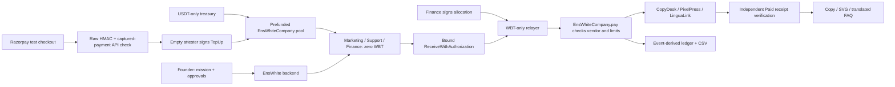

# EnsWhite architecture

Each vendor is an independent Node process with its own encrypted wallet and order database. Testnet delivery and earnings query chain receipts directly. The local simulator's event database is explicitly a test substitute.

The backend serializes jobs and saves signed bytes before submission. A timeout preserves the original transaction. Founder decisions are recorded separately. Model proposals pass through an allowlisted tool plan and deterministic code; the model never controls keys, prices or policy.

The original payment lab stays under `data/testnet`. The company uses `data/company/testnet`, vendors use `data/vendors/testnet/<vendor>`, and all private state is ignored by Git.
