# EnsWhite architecture

See the [complete seven-diagram walkthrough](project-flow.md) and [self-contained visual presentation](project-flow.html).

ENSv2 on Ethereum Sepolia is the identity and policy source. Whitechain Sepolia is the settlement network. The backend resolves ENS immediately before signing, and a trusted attester signs a request-bound policy that EnsWhiteCompany checks. There is no direct onchain read from Whitechain into Sepolia, and Razorpay fiat is simulated.

Each vendor is an independent Node process with its own encrypted wallet and order database. Testnet delivery and earnings query chain receipts directly. The local simulator's event database is explicitly a test substitute.

The backend serializes jobs and saves signed bytes before submission. A timeout preserves the original transaction. Founder decisions are recorded separately. Model proposals pass through an allowlisted tool plan and deterministic code; the model never controls keys, prices or policy.

The ENS company uses `data/company/ens-testnet`. Legacy company history remains under `data/company/testnet`, the original lab under `data/testnet`, and vendors under `data/vendors/testnet/<vendor>`. All private state is ignored by Git. Department Whitechain WBT stays zero; Sepolia record writes separately require Sepolia ETH.
