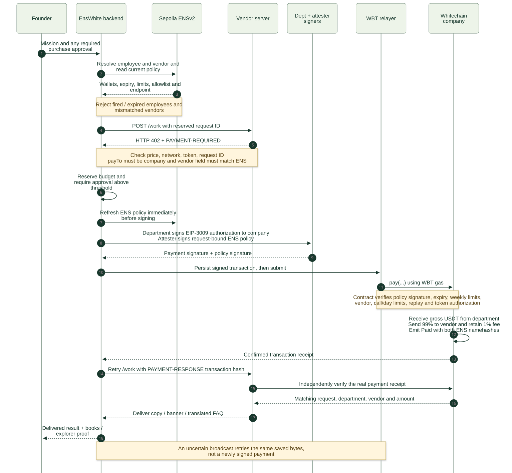

# EnsWhite: explain the project through diagrams

**Pitch:** EnsWhite gives AI departments an ENS identity, a controlled spending budget and the ability to buy work from independent vendors, with payments and receipts on Whitechain.

**Presentation order:** concept → architecture → funding → payment → ENS directory → employment → gas replenishment. Open [the self-contained presentation](project-flow.html) for a portable visual walkthrough. SVGs stay sharp when enlarged; `.mmd` files are editable Mermaid sources.

## 1. Conceptual overview

**Say:** “ENS is our HR department and company directory. Whitechain is our bank. EnsWhite connects them so only authorized, funded AI employees can buy work.”

The founder supplies a mission and approves budgets or exceptional purchases. Marketing buys copy and a banner; Support buys a translated FAQ; Finance authorizes allocations and keeps the books. Vendors receive payment before delivering work.

[Editable source](diagrams/01-concept.mmd)

## 2. System architecture

**Say:** “The backend coordinates the workflow, ENS supplies live identity and policy, and the Whitechain contract enforces signed payment authority and limits. Vendors verify receipts independently.”

| Component | Responsibility |
| --- | --- |
| Founder UI | Missions, purchase approvals, allocation approval, ENS management and books |
| Company backend | Authentication, Razorpay verification, deterministic policy, mission orchestration and custom x402 facilitation |
| SQLite and encrypted wallet store | Tasks, reservations, approvals, private custody data and signed transactions saved before broadcast |
| ENSv2 on Ethereum Sepolia, chain 11155111 | Registries and resolvers: identity, expiry, policy, vendor address/endpoint and scoped record permissions |
| Trusted attester | Signs verified sandbox top-ups and request-bound ENS policy attestations |
| Finance signer | Signs Whitechain allocations and delegated Sepolia weekly-budget edits |
| Department signers | Sign EIP-3009 payment authorizations and their own ENS status edits |
| WBT relayer | Sends company transactions on Whitechain and pays their gas |
| EnsWhiteCompany on Whitechain Sepolia, chain 1874 | Credits, allocations, payment authorization, spending limits, fees and events |
| Independent vendor servers | Issue HTTP 402 challenges, verify actual chain receipts and deliver results |
| Owner-operated gas watcher | Uses earned fees for a bounded YetiTrade swap when relayer gas is low |

**Trust boundary:** Whitechain cannot read Sepolia or Razorpay directly. The backend is a trusted verifier; its attester signs the facts Whitechain checks. This is a custodial hackathon demo, not a trustless cross-chain bridge.

[Editable source](diagrams/02-architecture.mmd)

## 3. Funding and allocation

**Say:** “A captured INR 500 sandbox payment unlocks 5 test USDT of credit against an already prefunded contract. It does not convert rupees or mint USDT.”

1. The business prefunds the contract with test USDT. The demonstrated pool was funded directly by the owner; treasury funding is also supported.
2. The founder completes Razorpay **test-mode** checkout.
3. The backend verifies the webhook HMAC and confirms the captured payment through Razorpay's API, including the server-created order, currency and amount.
4. An order-keyed job and the contract's payment-ID replay check prevent duplicate credit. The attester signs `TopUp`; the relayer submits it with WBT gas.
5. The contract checks the signature, deadline and available inventory, then records 5 test USDT of company credit. Credit is accounting backed by existing tokens.
6. The founder approves allocation. Finance signs; the backend checks active ENS identities and remaining weekly caps.
7. The relayer submits the authorizations. The contract transfers USDT to department wallets. The proposal is 60% Marketing, 30% Support and 10% Finance, reduced where caps are reached.

Departments need **no WBT for Whitechain payments**. They separately hold small amounts of **Sepolia ETH** for their ENS record edits.

[Editable source](diagrams/03-funding.mmd)

## 4. Agent payment and delivery

**Say:** “A vendor asks for payment using HTTP 402. We check ENS, budget and approvals, settle on Whitechain, and return the transaction hash. The vendor checks the chain before delivering.”

1. A mission selects allowlisted vendor tasks. Models, when enabled, cannot change prices, keys or deterministic policy. Demonstrated content used explicitly labelled fallback generators.
2. Fresh ENS reads confirm active employment, matching wallet, allowed vendor, and matching vendor wallet and endpoint.
3. The vendor returns `402` and `PAYMENT-REQUIRED`. The backend validates network, token, price, request ID and vendor field. **`payTo` is the company contract**, which must also match the configured deployment.
4. Budget is reserved. Above-threshold purchases wait for founder approval before signing.
5. ENS policy is refreshed immediately before signing. The department signs EIP-3009 `ReceiveWithAuthorization` **to the company contract**. The attester signs the request-bound ENS policy: employee/vendor nodes, wallets, limits and expiry.
6. The signed transaction is journaled. The relayer calls `EnsWhiteCompany.pay` and pays WBT gas.
7. The contract verifies policy signature, expiry, weekly limits, vendor, call/day limits, replay protection and token authorization. It receives gross USDT, sends 99% to the vendor and retains a 1% fee.
8. `Paid` records request, department, vendor, amount, fee and both ENS namehashes.
9. The backend retries the vendor request with `PAYMENT-RESPONSE`. The vendor independently checks the real payment receipt before delivering.
10. Results, event-derived books and CSV become available. Paid-but-undelivered tasks retry delivery without another charge. An uncertain broadcast preserves the original signed bytes.

This uses **x402 v2 HTTP envelopes with the custom `enswhite-receive` scheme**. The backend is its facilitator, not a hosted Whitechain facilitator or universal SDK integration.

| One mission | Gross test USDT | Vendor receives | Company fee |
| --- | ---: | ---: | ---: |
| CopyDesk copy | 0.100 | 0.099 | 0.001 |
| PixelPress banner | 0.200 | 0.198 | 0.002 |
| LinguaLink FAQ | 0.100 | 0.099 | 0.001 |
| Total | **0.400** | **0.396** | **0.004** |

[Editable source](diagrams/04-payment.mmd)

## 5. ENS directory and permissions

**Say:** “Employees are expiring, revocable and non-transferable. Vendors own permanent transferable identities. Each employee has its own resolver, which isolates its delegated permissions.”

- `enswhite.eth` links the platform, company and vendor registries on Sepolia.
- Each employee wallet owns its token. Its separate resolver stores Whitechain address coin type **2147485522**, weekly/per-call policy, vendor allowlist and manager.
- Finance can edit only `enswhite.budget.weekly` on employee resolvers. It cannot edit vendor allowlists or wallet records.
- Each employee may edit only its own `enswhite.status`. A persistent queue signs status and founder-requested budget edits with the correct scoped wallet.
- Company name/avatar/URL use a company resolver's default `0x00` record. The app inherits this branding; individual employee text keys do not automatically fall back to that resolver.
- Vendors control their address and `x402.endpoint`. Their registry is emancipated: dangerous root revocation roles are removed. **The ancestor owner can still change its own subregistry pointer.**

[Editable source](diagrams/05-ens-directory.mmd)

## 6. Hiring, firing, renewal and expiry

**Say:** “Hiring creates a token and resolver with a term and policy. Firing or expiry blocks fresh authorizations. Whitechain also checks signed expiry, so an expired employee cannot keep paying.”

Founders create company namespaces, hire, fire and renew. Finance can also renew through the contract. Rehiring creates a fresh resolver and token; status synchronization repopulates the new resolver. Team prepares founder-wallet transactions; the completed live lifecycle demonstration used the operator terminal.

**Timing:** an already-signed policy can remain valid for up to **60 seconds after firing**, never beyond name expiry. This is not instantaneous cross-chain cancellation.

Signup currently creates an ENS namespace and registry. A separate company's bank, funding and employee setup remain explicit operator steps; existing workspace funds are not silently moved.

[Editable source](diagrams/06-employment.mmd)

## 7. Automatic gas replenishment

**Say:** “The business pays gas. A separate owner process converts earned fees into WBT when the relayer needs it and the swap is economic. It never spends company credit as fees.”

The watcher starts a cycle below **0.05 WBT**, uses earned fee USDT and swaps at most **10 test USDT**. It checks direct USDT/wrapped-WBT liquidity and an economic gas margin before withdrawing fees. The owner pays execution gas and approves only the swap amount. A refreshed quote uses **0.5% slippage** and a **two-minute deadline**; atomic swap/unwrap delivers native WBT to the relayer. Previously withdrawn, unspent fee inventory is journaled. Small/illiquid pools remain untouched; repeated reverts pause the cycle.

This replenishes **Whitechain WBT**, not employee Sepolia ETH. A healthy relayer triggers no swap; the live payment demo did not force one.

[Editable source](diagrams/07-gas.mmd)

## A 60-second walkthrough

“A founder gives EnsWhite a mission and a budget. In our demo, Razorpay test checkout credits a prefunded test-USDT pool; no real fiat conversion happens. Finance allocates the budget to AI departments. Every department has an ENS identity, policy and employment expiry. Before buying work, the backend resolves the employee and vendor live, checks the quote and reserves budget. The department signs a payment authorization, our attester signs the ENS policy, and a WBT-funded relayer submits it. Whitechain enforces signatures and limits, pays the vendor and records both ENS identities. The vendor verifies the receipt before delivering. The founder sees results and books, while a separate owner process can recycle earned fees into relayer gas.”

## Scope and evidence

These diagrams describe the implemented core. Wildcard contractors, namespace aliasing and agent subteams are deferred. Wallet custody and the attester are trusted backend responsibilities. Delivery is retried, not automatically refunded. Live operation needs the local services, public tunnel, prefunding and gas on both networks.

[Public deployment/payment/lifecycle proofs](deployments/enswhite-testnets.json) · [README](https://github.com/swapnilyt1234/enswhite) · [ENS contracts](https://github.com/swapnilyt1234/enswhite/blob/main/ens/src/EnsWhiteNames.sol) · [Payment orchestration](https://github.com/swapnilyt1234/enswhite/blob/main/app/company.js) · [Whitechain contract](https://github.com/swapnilyt1234/enswhite/blob/main/src/EnsWhiteCompany.sol)
